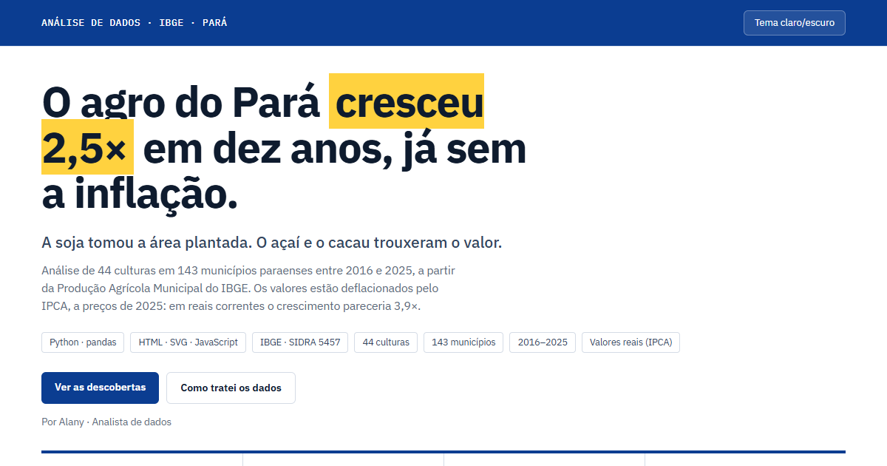
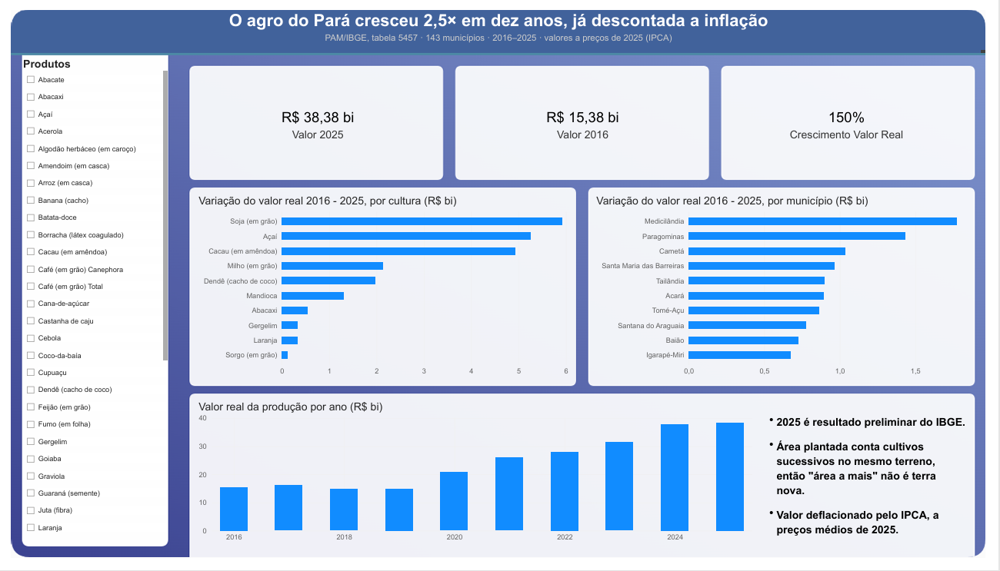

# Análise de dados sobre o agro no estado do Pará

> **O agro do Pará cresceu 2,5× em dez anos, já descontada a inflação. A soja tomou a área plantada. O açaí e o cacau trouxeram o valor.**

Projeto de portfólio de **Analytics Engineering**: de uma exportação bruta do IBGE até um dashboard, passando por tratamento, deflação pelo IPCA, modelo estrela e medidas em DAX. Base: 44 culturas em 143 municípios paraenses, 2016 a 2025 (Produção Agrícola Municipal, tabela 5457 do SIDRA).

**[▶ Ver o dashboard online](https://lanybcr.github.io/Analise-de-dados-sobre-o-agro-no-estado-do-Para-/)**

[](https://lanybcr.github.io/Analise-de-dados-sobre-o-agro-no-estado-do-Para-/)

## O que a análise mostra

| Descoberta | Número |
|---|---|
| Valor da produção, 2016 → 2025, **a preços de 2025** | R$ 15,4 bi → R$ 38,4 bi (**2,5×**) |
| O mesmo sem deflacionar | R$ 9,9 bi → R$ 38,4 bi (3,9×) |
| Área plantada, 2016 → 2025 | 1,57 → 3,37 milhões de ha (**2,2×**) |
| Área plantada a mais que é soja e milho | **76%** dos 1,8 milhão de ha |
| Valor novo que vem de soja, açaí e cacau | **70%** dos R$ 23,0 bi a mais |
| Açaí e cacau | 13% da área plantada, **38%** do valor |

Dois cuidados que o dashboard já avisa: comparar valores sem deflacionar infla o crescimento (o IPCA acumulou 56% no período), e "área plantada" conta cultivos sucessivos no mesmo terreno, então não é sinônimo de terra nova.

## O que eu entrego

Se você tem uma base pública ou interna difícil de usar, este projeto mostra o que eu faço com ela:

| Etapa | Entrega |
|---|---|
| **Tratamento** | Exportação do SIDRA (3 abas, cabeçalho em 3 níveis, símbolos no lugar de números) vira base limpa, com validação: o total de cada município fecha com a soma das culturas em 1.420 de 1.420 casos |
| **Análise** | Valores deflacionados pelo IPCA, achados calculados por script e reproduzíveis |
| **Modelagem** | Modelo estrela (1 fato e 3 dimensões) gerado por código, conferido contra a base tratada |
| **Dashboard** | Em **HTML** (online) e em **Power BI** com medidas **DAX** |
| **Transparência** | Limitações e hipóteses declaradas, sem esconder o que a base não permite afirmar |

## Versão em Power BI



Arquivo [`powerbi/agro_para.pbix`](powerbi/agro_para.pbix), sobre o modelo estrela em `data/modelo/`:

| Tabela | Papel |
|---|---|
| `fProducao` | Fato: município × ano × cultura, com área e valor (nominal e a preços de 2025) |
| `dMunicipio`, `dCultura`, `dTempo` | Dimensões, ligadas à fato por relações 1:N |

Exemplo de medida (exclui o café Canephora, subcomponente do Café Total, para não contar o café duas vezes):

```dax
Valor Real mil = CALCULATE ( SUM ( fProducao[valor_real_mil_reais] ), dCultura[flag_subcomponente] = FALSE () )
```

## Reproduzir

```bash
pip install -r requirements.txt
python src/tratamento_pam.py data/raw/tabela5457_2016-2020.xlsx data/raw/tabela5457_2021-2025.xlsx --saida data/tratado --prefixo Culturas_Para_2016-2025
python src/analise.py          # achados + dashboard (index.html)
python src/modelo_estrela.py   # modelo estrela para o Power BI
```

## Limitações

- **2025 é resultado preliminar** do IBGE e pode mudar.
- A base traz **área e valor**, não quantidade nem rendimento. "Valor por hectare" mistura preço e produtividade.
- Explicações que dependem de dados de fora da base (como a alta do cacau em 2024) estão marcadas como **hipótese**.
- A série começa em 2016, período exportado do SIDRA.

## Autoria e fonte

Projeto de **Alany Cruz** · [GitHub](https://github.com/lanybcr). Código sob licença [MIT](LICENSE); dados do IBGE (PAM, tabela 5457; IPCA, tabela 1737), de uso livre mediante citação.
